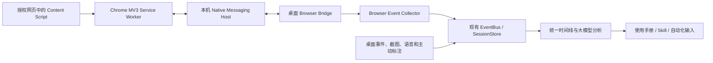

# Skill Recorder 离线 Chrome 浏览器助手设计

状态：长期设计；首版已实现，实际能力及剩余范围见 [安装与验证](browser-companion.md)。日期：2026-10-10。

## 1. 范围与结论

增加一个可选的 Chrome Manifest V3 插件，与桌面录制并行工作。浏览器内采集真实事件与目标元素信息；离开浏览器后，桌面录屏、语音、主动点击标记、框选和局部截图继续工作。两路证据合并为同一条轨迹，后续用于使用手册、Skill 和浏览器自动化输入。

本次仅考虑离线分发的桌面 Chrome，支持现有 macOS 和 Windows x64 应用；不考虑 Edge、扩展商店、Windows ARM64、企业强制安装、远程服务或自动回放执行器。“离线”指插件分发、连接和事件传输不依赖外网；访问的网页和现有模型接口是否联网由其本身决定。

采用以下组合：

- 插件：真实事件采集、语义化元素描述、定位候选、页面上下文。
- 桌面端：录制生命周期、截图、语音、时间对齐、落盘、模型分析。
- 本机 Native Messaging 桥接程序：连接 Chrome 插件与运行中的桌面应用。
- 后续执行器：重新定位与验证，例如 Playwright；不在本次录制插件中执行模型指令。

浏览器“录制→脚本”是成熟能力，可参考 Playwright Codegen、Selenium IDE、Chrome DevTools Recorder。可靠测试仍需要断言、测试数据与环境管理；本项目的跨应用语义轨迹和 Skill 生成不能直接等同于成熟的自动化测试框架。

## 2. 离线分发能自动完成什么

| 动作 | 方式 |
|---|---|
| 插件与桥接程序随应用到达设备 | 自动，安装包包含全部文件 |
| 桥接程序落盘、Native Messaging 注册 | 自动，当前用户范围，无需系统管理员权限 |
| 打开插件目录、显示安装说明 | 桌面应用提供按钮 |
| 首次让 Chrome 接受插件 | 用户在 `chrome://extensions` 开启开发者模式，点击“加载已解压的扩展”，选择目录 |
| 已加载插件与运行中应用建立连接 | 自动，按固定扩展 ID 和本机桥接注册连接 |
| 开始/停止录制、事件落盘 | 桌面端控制，自动同步 |
| 插件升级 | 应用携带新版文件；空闲时协调更新与 `chrome.runtime.reload()`，失败时提示手动重新加载 |
| 用户卸载或禁用插件后的恢复 | 用户重新启用/加载，不绕过 Chrome 的选择 |

普通用户的离线 Chrome 没有供桌面应用静默启用任意插件的受支持安装接口。不能把“随安装包提供”描述成“首次零操作启用”。不修改 Chrome 的 Preferences/Secure Preferences，不使用强制启动参数加载插件，不操作企业策略绕过首次启用。

插件需要在实际使用的 Chrome 配置文件中加载一次；不同配置文件相互独立。开发者模式的浏览器提示可能继续存在，桌面端不抑制这些提示。

## 3. 用户流程

### 首次安装

1. 安装或启动 Skill Recorder。桌面端部署本机助手，检查当前用户的 Chrome Native Messaging 注册。
2. 设置页显示“Chrome 浏览器助手 · 待加载”，以及“打开扩展管理页”“打开插件目录”两个按钮。说明只列三步：开启开发者模式、加载已解压扩展、选择已打开的目录。
3. 用户在 Chrome 加载插件。固定公钥确保扩展 ID 与安装目录、桌面应用版本无关。
4. 插件通过 Native Messaging 自动连接本机应用，交换协议版本、能力和连接实例 ID。设置页变为“已连接”。不增加账号、外网下载或配对码步骤。
5. 用户在插件弹窗选择“记录当前标签页/授权当前站点”。此用户操作提供 `activeTab` 临时权限；需要持续访问的站点再按需请求持久权限。

### 每次录制

1. 用户按现有方式选择屏幕或应用窗口，点击桌面端“开始录制”。
2. 桌面端发出录制会话 ID、授权范围、绑定窗口/标签页及时间同步信息。
3. 插件只采集本次会话允许的标签页与站点。桌面端没有运行、没有开始录制、站点没有授权时，不持久化操作内容。
4. 用户操作浏览器时，真实事件进入轨迹；操作其他应用时，原有录制继续。不得因为插件断连而终止整条录制。
5. 用户点击“完成”。插件停止产生新事件，发送剩余批次；桌面端在限定时间内确认接收，再关闭会话。插件记录指示同步熄灭。

### 状态提示

桌面设置页：`待加载 / 已连接 / 浏览器未运行 / 版本不兼容`。

录制工具栏使用小型 Chrome 状态图标，悬停显示：`浏览器事件已接入 / 当前站点未授权，仅录制画面 / 插件连接中断，仅录制画面`。保持当前截图、框选、点击工具为纯图标。

插件弹窗显示连接状态、录制状态、当前绑定页面、当前站点授权和“打开 Skill Recorder”。Chrome 插件不能可靠获取用户的配置文件显示名称；用本地生成的连接 UUID 与用户可编辑名称区分多个连接，不读取登录账号。

## 4. 架构



Chrome 通过标准 stdin/stdout Native Messaging 协议启动一个小型原生桥接程序。建议用 Go 实现独立二进制，按现有发布架构构建；不依赖用户安装 Node/Python，也不借助 Electron 的普通 GUI 启动入口承载协议。

桥接程序连接桌面应用已创建的本机 IPC：macOS 使用当前用户私有目录的 Unix socket；Windows 使用仅当前用户可访问的 named pipe。桌面端在用户数据目录写入受保护的发现文件，记录本次 endpoint、进程实例、协议范围和随机连接令牌。

不开放 HTTP/WebSocket 监听端口，不向网页暴露桌面 RPC。网页采集脚本只能向插件发送预定义录制事件，不能调用桌面命令、读取任意文件或执行模型生成的脚本。

Native Messaging host 固定名称建议为 `com.skillrecorder.browser`。manifest 的 `allowed_origins` 只包含最终固定的 Chrome 扩展 ID；示例占位符不得进入正式安装包。stdin/stdout 只传协议内容，日志写 stderr。

## 5. 插件采集内容

| 事件 | 最小信息 | 采集策略 |
|---|---|---|
| `browser.click` | 目标、鼠标按钮、点击次数、定位候选、页面/Frame、位置 | 记录可信的用户 `click`；用此前的 `pointerdown` 捕获可能马上被移除的目标上下文 |
| `browser.input` | 字段语义、输入类型、最终值引用 | 合并 input/change，约 300–500ms 防抖，blur/停止时提交；不记录逐字符击键 |
| `browser.select` | 下拉框语义、所选选项 | 捕获用户 change，并与 input 合并避免重复 |
| `browser.check` | checkbox/radio 语义与最终状态 | 以最终 checked 状态为准 |
| `browser.scroll` | 页面/容器、滚动位置 | 防抖合并；只保留影响后续操作定位的滚动 |
| `browser.navigation` | 脱敏 URL、标题、文档身份、导航类别 | 覆盖普通导航与 SPA 路由，限本次允许的 Tab/Frame |
| `browser.tab` | 被绑定的标签页激活/关闭、新页面关联 | 新标签页不默认扩展授权；记录跳转关系后由用户授权或按已批准范围接入 |
| `browser.key` | Enter/Escape/Tab 等动作键及目标 | 只记有操作意义的按键，不采集密码或普通文本字符 |

不采集完整 DOM、完整 HTML、全部网页文本、网络响应或 Cookie。password 字段和明确的密码/令牌输入不采集内容。可用于参数化的普通输入由桌面端生成 `valueRef`，模型只看到经脱敏的值/占位符；不得把插件原始 input 值直接交给现有模型工具。

### 元素描述与定位候选

每个目标记录可访问角色/名称、label、短可见文本、tag/type、稳定 id、明确测试属性，以及有限的祖先语义。候选定位优先顺序：

1. 唯一且符合语义的 role + accessible name。
2. label、placeholder、稳定测试属性。
3. 稳定 id 或有明确上下文的 CSS。
4. 必要时的结构路径，标记为弱候选；不把动态 class、坐标或 `nth-child` 当成可靠默认定位。

记录候选在当时页面的匹配数量及适用的 Frame/Shadow root 范围。插件没有浏览器内部完整可访问性树权限，不能声称自行推导的 accessible name 与 Playwright 完全一致；执行时必须重新计算并验证。

同源 iframe 和开放 Shadow DOM 在首版支持。跨域 iframe 需要对应站点权限和 Frame 注入；未授权时只记录缺失能力。关闭 Shadow DOM、canvas 内部控件、浏览器内部页面不能提供同等 DOM 定位，按宿主/画面证据记录，明确定位能力等级。

## 6. 权限与注入

首版 manifest 使用 MV3，service worker + popup + 本地 content script，无远程代码。

```json
{
  "manifest_version": 3,
  "name": "Skill Recorder 浏览器助手",
  "version": "0.1.0",
  "permissions": ["nativeMessaging", "storage", "scripting", "activeTab"],
  "optional_permissions": ["webNavigation"],
  "optional_host_permissions": ["https://*/*", "http://*/*"],
  "background": { "service_worker": "service-worker.js", "type": "module" },
  "action": { "default_popup": "popup.html" }
}
```

正式构建还必须注入固定 `key`、图标和协议版本；上面仅是权限与结构示例。

默认由用户点击插件绑定当前页面，按授权注入。持久站点权限仅按实际站点请求；需要完整导航追踪时解释用途并申请可选 `webNavigation` 权限。未获该权限时，用授权页面的文档握手、重新注入和 URL 变化记录有限导航能力，不伪装为完整导航采集。

跨站跳转失去权限时，桌面录屏继续，提示站点未授权。`chrome://`、扩展管理页和其他不可注入页面使用画面证据。`file://` 页面放到后续可选支持，需要 Chrome 的“允许访问文件网址”选项，不默认读取本地文件。

Native connection 可维持 MV3 worker 活跃，但断连后 worker 仍可能被回收。录制状态放在 `chrome.storage.session`，事件队列用有界 IndexedDB；不能把内存全局变量当作唯一状态。缓存仅属于当前录制，默认不跨浏览器重启恢复录制权限。

## 7. 事件与会话协议

建议公共协议放在 `common/browser-protocol.ts`，用 Zod 校验。两个端点都验证版本、会话 ID、连接 ID、事件类型与消息大小。单条协议消息控制在 128KB 内，事件按批发送；截图由桌面端保存，首版不经 Native Messaging 传输图片。

消息集合：

- `hello / hello_ack`：插件、桥接、桌面版本与支持的协议范围、连接 UUID、能力。
- `session_start / session_ready`：本次 sessionId、授权和绑定范围、时间同步。
- `events / events_ack`：批次 ID、插件递增序号、事件列表、已持久化确认。
- `session_stop / session_stopped`：停止与队列排空。
- `status / error`：连接、权限、队列缺口、关闭页面等状态。
- `prepare_update / update_ready / reload_extension`：仅空闲时的本地升级协作。
- `open_app`：仅用户点击插件按钮时，启动注册时确定的应用路径；无任意命令参数。

录制事件例子：

```json
{
  "protocolVersion": 1,
  "sessionId": "20261010-120000-example",
  "connectionId": "chrome-connection-uuid",
  "eventId": "document-uuid:42",
  "clientSeq": 42,
  "kind": "browser.click",
  "clock": {
    "capturedEpochMs": 1791604802500,
    "documentElapsedMs": 8500
  },
  "context": {
    "tabId": 12,
    "windowId": 3,
    "documentId": "chrome-document-id",
    "frameId": 0,
    "url": "https://example.test/profile",
    "title": "个人资料",
    "scope": "bound-tab"
  },
  "target": {
    "role": "button",
    "accessibleName": "保存",
    "tagName": "BUTTON",
    "locatorCandidates": [
      { "kind": "role", "role": "button", "name": "保存", "matchCount": 1 }
    ],
    "rect": { "x": 820, "y": 540, "width": 80, "height": 32 },
    "coordinateSpace": "frame-viewport-css",
    "locatorConfidence": "semantic-unique"
  },
  "action": { "button": 0, "detail": 1, "isTrusted": true }
}
```

定位候选是结构化数据，不是可执行 JavaScript 字符串。Frame/Tab ID 是录制期路由身份，不能直接作为未来 Playwright 的定位器。

桌面端落盘前生成 `source: browser-extension` 的类型化事件，保留 `eventId`、连接身份、事件发生时间、接收时间和定位信息。按 eventId 去重，不能因重连重复增加步骤。ACK 必须在存储实际完成后发送；现有 SessionStore 的流式 `append()` 没有持久化 ACK，需要增加异步批次写入/flush 接口。

## 8. 时间、窗口与截图关联

### 时间

插件采集时间不能简单用桌面收到消息的时间替代。会话开始进行多次往返校时，选择延迟低的样本，记录偏移量和误差；同一文档保留单调序号，导航后重新建立文档时钟。桌面休眠/唤醒或明显时钟跳变时重新同步。

保留现有 RecEvent 的接收时序和 seq，增加标准化的事件发生时间字段。为 `common/bundle.ts`、`common/correlation.ts` 和分析工具引入统一事件时间读取方法，按发生时间与确定性 tie-break 合并，而不是只按 JSONL 到达顺序拼接。停止时只接收发生于录制区间且属于该会话的迟到事件；超时/丢包写入覆盖率，不重开已结束的会话。

### 窗口

Chrome `windowId/tabId` 与系统原生窗口 ID 不是同一种标识，不得直接相等比较。

首版以明确绑定的 Chrome 标签页为范围。利用插件上报的窗口边界、页面标题、浏览器进程和原生录制窗口信息建立关联；有多个相似窗口或配置文件时要求用户在插件选择“绑定当前标签页”，并在桌面端确认来源，不猜测绑定。

录制某个应用窗口时，只接收绑定到该窗口的浏览器事件。录制屏幕时，校验事件目标属于所选屏幕上的有效浏览器窗口。后台标签页、其他 Chrome 连接、未选屏幕和录制结束后的操作不得混入。

### 截图与坐标

DOM rect 属于 Frame 的 CSS viewport；截图像素、桌面 DIP、浏览器窗口边界、浏览器工具栏、缩放、devicePixelRatio、VisualViewport 和 iframe 偏移是不同坐标层。必须保留坐标空间和转换依据；不能直接把 DOM 坐标乘 devicePixelRatio 当作屏幕位置。

首版把浏览器事件与现有录制帧关联，同时请求带 ACK 的即时后置截图。升级当前 `captureSnapshot()`，返回 frameId、实际采集时间与存储结果。

- 前置画面使用点击前最近的已录制帧，注明距离实际点击的时间；不声称是精确按下瞬间。
- 后置截图使用实际采集时间，并关联到 eventId；页面跳转或动画未完成时可追加有限的稳定后置画面。
- DOM/目标描述在 pointerdown 时采集，避免页面跳转后丢失；最终点击事件仍以可信 click 为准。
- 坐标转换无法验证时，不在桌面截图上画一个猜测位置的图标，保留 DOM 坐标和定位候选供执行器使用。
- 截图失败时写明缺失证据，不删除已确认的真实点击事件。

用户主动标记点击、框选和局部截图保持现有 `marker` 机制，与 `browser.click` 分开展示。前者表达意图，后者证明捕获了真实用户动作；两者都不能独自证明业务操作成功。

## 9. 分析与自动化输入

扩展 `common/events.ts`、事件相关性集合和 bundle，增加浏览器动作摘要与定位证据索引。与现有系统 URL 采集并存时，优先使用授权插件的精确页面事件，按来源和时间去重，不生成两次同一导航。

分析工具提供分页 `get_browser_actions`，返回操作、元素、定位候选、前后截图引用和附近语音；提供覆盖率和缺失原因。模型必须先读完浏览器真实动作，再结合主动标注和画面解释流程。相同动作的点击/input/change 应先规范化，避免机械地每个底层事件变成一个步骤。

证据分工：

- 操作事实：浏览器真实事件优于仅凭画面的推断。
- 用户关注点和意图：语音、主动点击标记、框选、局部截图提供解释。
- 操作结果：页面/业务状态变化和明确验证；缺失时标记“结果未验证”。

脱敏层必须新增 browser 事件与嵌套 target/context 的处理。当前 `electron/sensitive/scanner.ts` 是按现有事件字段扫描，不能假设新增字段会自动被覆盖。

生成自动化输入时输出：动作、页面/Frame 上下文、定位候选、参数引用、前置条件、预期结果和证据等级。执行器在当前页面重新验证唯一性、可见性、可操作性和结果。首版不默认把点击后的某段文字推断为业务断言，也不保证任何录制都能直接转换成稳定测试。

## 10. 随桌面应用打包与部署

建议新增结构：

```text
browser-extension/                   # Chrome MV3 源码
native/browser-host/                 # 独立 Go 桥接程序
common/browser-protocol.ts           # 公共消息契约
common/browser-events.ts             # 元素、定位、时钟和动作模型
scripts/build-browser-companion.mjs  # 离线资源构建与校验
scripts/verify-browser-companion.mjs # 打包产物校验
resources/browser-companion/
  extension/                        # 已构建、可加载的插件目录
  native-host/<platform-arch>/       # 对应二进制
  companion.json                    # ID、版本、协议范围、文件摘要
  INSTALL-ZH.md                     # 离线安装说明
  LICENSES/                         # 桥接依赖与插件许可证
```

通过现有 electron-builder 的 `extraResources` 分发 `browser-companion`。禁止把需要执行/修改的桥接程序或插件安装目录放在 app.asar 中。

### 安装路径

插件使用固定的当前用户目录，例如 `app.getPath('userData')/browser-companion/extension`。Chrome 加载此稳定目录，而不是 `.app` 内部、临时目录、版本目录或源码 checkout。用户移动应用或升级版本后不需要重新选择插件目录。

桥接程序按版本安装在 `userData/browser-companion/hosts/<version>/`，host manifest 原子更新到当前二进制的绝对路径。Windows 运行中的旧 host 不会被强行覆盖；新连接使用新版本，旧连接在安全边界退出。

| 平台 | 注册位置 | 部署时机 |
|---|---|---|
| macOS Chrome | `~/Library/Application Support/Google/Chrome/NativeMessagingHosts/com.skillrecorder.browser.json` | 首次启动/升级时在当前用户范围注册 |
| Windows Chrome | `HKCU\Software\Google\Chrome\NativeMessagingHosts\com.skillrecorder.browser`，默认值指向 manifest 绝对路径 | 当前用户安装/首次启动时注册 |

开发环境使用独立 host 名称和扩展身份，避免覆盖已安装版的连接。固定扩展公钥进入仓库，私钥不进入安装包；CI 根据公钥校验扩展 ID，并生成 `allowed_origins`。

现有 Windows NSIS 是 per-user 安装，适合这一路径。macOS 当前是 ad-hoc 签名，发布桥接二进制时应纳入完整签名与后续公证流程；文档不把当前产物描述为已经满足正式签名分发。

### 升级

1. 新安装包携带插件、host、版本契约与摘要，不从外网下载组件。
2. 校验资源完整性，先安装新版 host 和暂存插件文件。
3. 正在录制时延后插件切换，保持当前会话协议和队列完整。
4. 空闲时插件回应 `prepare_update`；桌面端更新稳定目录，全部文件落盘后通过仍在线的旧连接发 `reload_extension`。
5. 旧 worker 调用 `chrome.runtime.reload()`，新版重连并完成 hello；失败保留上一个完整版本，提示 Chrome 管理页中的“重新加载”。
6. 新增站点或可选权限仍需用户在 Chrome 授权，不通过升级自动扩大权限。

应用/插件/host 不要求版本号相同，按协商的 protocolVersion 和 capabilities 工作；至少保留一个上一代协议窗口，避免桌面升级使未重载的插件完全失效。

### 卸载与修复

保存部署收据，只移除本产品拥有的 native host 注册、manifest 和组件，不修改其他扩展。Chrome 中的插件条目由用户移除；保留或删除录制数据沿用现有应用行为。macOS 拖走应用不保证触发卸载 hook，因此设置页提供“移除浏览器助手配置”和“修复连接”。离线诊断必须能区分：插件未加载、错误的配置文件、native host 未注册、路径失效、版本不兼容、站点未授权。

## 11. 实施顺序与验收

| 阶段 | 交付 | 验收 |
|---|---|---|
| A：离线连接与分发 | 固定扩展身份、构建资源、native host、桌面状态与安装引导 | 断网的新 Chrome 配置文件手动加载一次后自动连通；Windows x64 与 macOS 路径含空格时可用 |
| B：真实操作轨迹 | 点击、输入、选择、滚动、导航、会话范围、去重和时间对齐 | 浏览器与桌面混合录制不丢桌面轨迹；后台/未授权页面不混入；重连不重复记录 |
| C：截图与模型证据 | 即时截图 ACK、定位候选、脱敏、分页分析工具 | 模型能解释真实按钮操作，并区分主动标注；长录制后半段仍可分析；缺图不伪造 |
| D：可复用自动化输入 | 参数与结果验证建议、结构化 locator 导出 | 改窗口大小/滚动位置后仍能按语义定位；有多个“保存”按钮时使用上下文，不盲目取第一个 |

首版验收还应覆盖：导航即销毁元素、SPA、同名按钮、iframe/Shadow 边界、页面缩放、高 DPI、多窗口、多个 Chrome 配置文件、服务 worker 回收、应用关闭、停止时迟到事件、截图失败、密码输入、升级与卸载。

浏览器自动执行和测试断言是后续独立模块，不在插件采集阶段顺便引入任意执行通道。

## 12. 对现有仓库的具体改动点

- `electron/recorder/collector.ts`：接入 BrowserCollector，并保持失败不阻断桌面录制。
- `electron/recorder/session-store.ts`：批次落盘 ACK、标准化发生时间、去重索引。
- `electron/main.ts`、`electron/ipc.ts`：桥接生命周期、连接状态、安装/修复、录制边界同步。
- `electron/video/recorder.ts`：截图请求 ID、采集时刻和写入完成 ACK。
- `common/events.ts`、`common/correlation.ts`、`common/bundle.ts`：类型、事件时间与浏览器步骤语义。
- `electron/describer/tools.ts`、`electron/describer/instructions.ts`：真实动作工具、覆盖率与证据优先级。
- `electron/sensitive/scanner.ts`：浏览器字段与嵌套信息的脱敏，不漏 URL、字段值和控件文本。
- `src/Recorder.tsx`、`src/RecordingControls.tsx`：安装状态、范围绑定和录制期间的小图标状态。
- `package.json`、`build/installer.nsh`、发布脚本：资源打包、用户级部署、卸载收据和架构校验。

## 13. 官方参考

- [Chrome Native Messaging：协议与注册](https://developer.chrome.com/docs/extensions/develop/concepts/native-messaging)
- [Chrome 加载已解压扩展](https://developer.chrome.com/docs/extensions/get-started/tutorial/hello-world#load-unpacked)
- [Chrome 外部分发：Windows/macOS 的商店与确认限制](https://developer.chrome.com/docs/extensions/how-to/distribute/install-extensions)
- [MV3 Service Worker 生命周期与 Native Messaging](https://developer.chrome.com/docs/extensions/develop/concepts/service-workers/lifecycle)
- [Chrome runtime API，包括 reload](https://developer.chrome.com/docs/extensions/reference/api/runtime)
- [Playwright Codegen](https://playwright.dev/docs/codegen)
- [Chrome DevTools Recorder](https://developer.chrome.com/docs/devtools/recorder)
