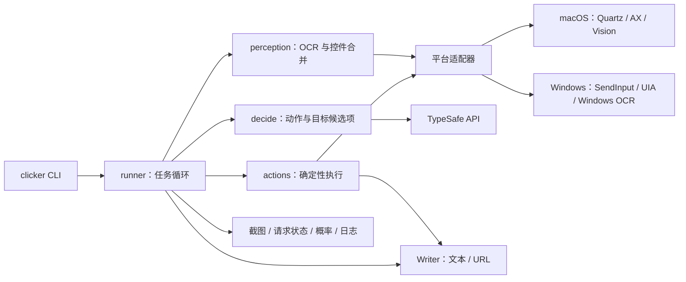

# typesafe-computer-use 源码评估

评估日期：2026-10-13。分析对象为 [awlevin/typesafe-computer-use](https://github.com/awlevin/typesafe-computer-use)，固定提交 `44ca11f0935b021b73020825da054b5c92cc1288`，Python 包版本 `0.2.0`，MIT 许可证。

## 结论

这是已有命令行入口的 Python Computer Use Agent。最值得借鉴的是“结构化感知 → 有限候选项分类 → 确定性执行 → 再观察”的任务循环。它可以作为独立 Computer Use CLI 的参考，但直接封装不能满足完整的跨平台原子控制接口：Windows 尚无真实运行验证，决策默认依赖 TypeSafe 服务，CLI 面向目标任务而非窗口和动作命令。

评估时在临时目录安装锁定依赖并运行离线测试，没有运行真实桌面 Agent。随后按用户要求改为直接复用上游 CLI，安装在 `/Users/qinxiao/WorkSpace/open/typesafe-computer-use`，使用说明见 [computer-use.md](computer-use.md)。此前未完成的自研 jev 适配器已撤回；下述原子 CLI 接口仅为评估建议，尚未实现，也不是当前优先路线。

## 实际架构



- `platform_adapter.py` 用 `Desktop` Protocol 隔离平台 API；`using(adapter)` 可替换为远端桌面。适配器栈为进程全局状态，源码明确说明不能跨线程同时操作不同桌面。
- `perception.py` 截取主显示器，读取前台应用、窗口、焦点字段和 URL；在窗口区域执行 OCR，再与无障碍控件合并。每项保留文字、角色、区域、来源和坐标，控件引用留在进程内。
- `decide.py` 调用 `TypeSafeClient.system_one`，在一次请求中回答动作类型、屏幕目标、网站，必要时增加屏幕外控件。单个 Choice 上限 255 项。点击置信度取动作和目标置信度的较小值。
- `actions.py` 优先 AXPress / UIA Invoke；失败后点击坐标。输入优先设置控件值并回读，否则清空字段后模拟键盘输入。模型生成文本的输入可以另发一次 TypeSafe 请求验证。
- `runner.py` 在动作后清除缓存观察，下一轮重新采集。检测无变化、重复动作和循环；低置信度、完成、停滞、步数限制都会结束或交给 Writer 复核。
- Writer 可生成输入文本、URL、最终回答或下一步关注点，支持 Anthropic 和 OpenAI 兼容接口。它可间接指导下一步，但动作仍由分类器选择。

项目愿景写着结构优先、OCR 回退；当前桌面实现仍然每轮执行 OCR（可利用缓存），随后读取 AX。独立浏览器后端才是完全不使用 OCR 的 DOM 路径。

## CLI 和模型依赖

现有入口：

```sh
uv run clicker "打开目标页面"                 # 一次观察和决策，不点击
uv run clicker "打开目标页面" --act --steps 20
uv run clicker-inspect "目标" --no-open      # 截图与请求状态检查
uv run clicker-bench loop --fixture         # 独立 Chrome 测试路径
```

这里的 dry run 仍会读取屏幕、调用 TypeSafe 并写入运行目录。它不是没有副作用的离线模式。

`TYPESAFE_API_KEY` 是 `clicker` 的必要配置。锁定 SDK 默认连接 `https://api.typesafe.ai`，模型为 `jev-latest`；SDK 支持环境变量覆盖地址和模型，但这不等于支持任意 OpenAI 兼容模型。只替换 Writer 不会替换核心分类器。屏幕文字、应用、URL、焦点字段摘要等进入分类请求；Writer 在启用视觉时还会接收截图。

当前 CLI 没有独立的 `windows list`、`observe --window`、`click`、`drag`、通用组合键等命令，也没有适合应用复用的常驻 JSON-RPC 服务。目标任务 CLI 和原子动作 CLI 需要分开设计。

## 平台支持证据

| 路径 | 实现 | 已知边界 |
| --- | --- | --- |
| macOS | PyObjC Quartz 事件、AX 控件、AppleScript 应用与 URL、Vision OCR | 要求 macOS 14+；主显示器；需要录屏与辅助功能权限；本次没有真实桌面验证 |
| Windows | ctypes SendInput、pywin32、uiautomation、winocr；设置 per-monitor DPI awareness | 上游明确标注 experimental、未在真实 Windows 测试；英文 OCR 硬编码；仅主显示器 |
| 浏览器 | CDP Runtime.evaluate 读取 DOM；Input 事件点击和输入 | 独立临时 Chrome profile；单页面；无 iframe / shadow DOM 穿透；Windows Chrome 可执行文件发现尚不完整 |
| Linux | OSWorld 远程桌面适配器，可选 RapidOCR | 不是普通 Linux 本机桌面适配器 |

Windows URL 通过名字匹配 `address` 的 Edit 控件读取，本地化地址栏需要补充。Windows `type_text` 逐 UTF-16 单元发送，但内部没有逐字符取消检查；点击和按键发送也没有 macOS `_down_then_up` 那样的 `finally` 释放保障。任务边界仍有取消检查，不能据此宣称整个 Windows 路径完全没有停止能力。

桌面观察由多个系统查询组成，并非原子快照。分类请求期间切换焦点或改变窗口，会使坐标失效；动作前没有统一的目标窗口身份、观察 TTL 与几何一致性检查。将它改为外部可调用动作 CLI 时，应增加这一边界。

macOS `screenshot()` 每次创建临时目录而未在该函数内清理；长任务需要补充资源生命周期。浏览器后端也会在 DOM 元素上写入 `data-tscu` 属性，不能当成完全无页面变更的观察方式。

## 浏览器路径与现有插件的关系

该项目不是 Chrome 扩展。`clicker-bench` 启动专用 Chrome，并用 CDP 读取 DOM 与输入事件；默认不接管用户已有 profile，因此不能直接继承现有登录状态。`find_chrome` 主要列出 macOS 路径及 Linux executable 名称，Windows 桌面适配器的存在不代表浏览器启动路径也已完整跨平台。

Skill Recorder 现有扩展监听用户操作并传输录制事件。可共享元素描述、定位与协议基础，但自动执行需要单独会话、请求类型和控制状态。录制接收事件和控制浏览器是不同生命周期。程序生成的动作是否进入录制，应通过明确的会话关联和来源字段定义。

## 验证与成本声明

在临时目录 `/private/tmp/typesafe-computer-use-review` 使用 `uv sync --frozen` 和 Python 3.12.11：

- 首次测试：728 passed，1 failed，3 skipped，1 xfailed，24.32 秒。失败为 `test_no_browser_process_or_network_is_reachable`，网络保护遇到环境代理后发生 TLS 超时。
- 只在测试进程禁用代理后：729 passed，3 skipped，1 xfailed，20.48 秒。未修改上游源码，测试保护保持启用。
- 测试替代或阻止真实系统输入、截图、应用控制和 CDP。这证明离线逻辑通过，不证明真实 macOS / Windows 可用。

README 的约 `$0.0002/step`、模型延迟和 DOM 性能数据为作者报告，本次未复测。它不是完整任务成本保证：Writer、额外输入验证、交接、重试和任务步数都会增加成本，原生桌面默认动作后等待 2 秒。

仓库最新一份提交的 OSWorld 记录 `20260929T164943Z.jsonl` 是 6 个 Chrome 任务，6 个评分为 1，平均记录耗时约 54.7 秒。此前记录包含失败、重复任务和旧提交；不应合并为完整 OSWorld 成功率，也不能据此证明 Windows 或中文办公任务效果。CPU、峰值内存、真实模型费用本次未测。

## 对独立 CLI 的建议

1. 将无模型原子控制做成可独立运行的核心：权限诊断、窗口列表、目标观察、控件或坐标点击、文本、快捷键、滚动、拖拽和取消。每次观察绑定窗口身份、坐标空间和有效期，动作后失效。
2. 加一层可选 `run <goal>` Agent，模型提供者可插拔。借鉴它的候选项分类，初期也可以用现有 OpenAI 兼容模型做结构化动作选择；这不能继承 TypeSafe 的置信度校准和价格承诺。
3. 借鉴 OCR 变化区域缓存、OCR/AX 去重、重复标签的同行上下文、停滞检测和逐步证据；原生 Windows 路径补取消、释放、本地化和真实 DPI 验证。
4. CLI 输出机器可读 JSON，软件内独立入口复用同一核心。与录制模块共享基础设施时，明确控制会话归属与并发规则。
5. 如直接使用 Python 代码，需配送 Python 与平台依赖并保留 MIT 声明；若采用项目现有 TypeScript + 原生 helper，适合移植设计，不能声称原版实现或性能自动保留。

以上是评估时提出的扩展方向。当前按用户决定直接复用上游 CLI，优先验证 macOS 任务闭环，再适配软件内入口和验证 Windows；不继续自建控制核心。复用时仍需处理服务依赖与上述运行边界。

## 主要源码入口

所有链接固定到本次分析的提交：

- [CLI](https://github.com/awlevin/typesafe-computer-use/blob/44ca11f0935b021b73020825da054b5c92cc1288/typesafe_computer_use/cli.py)
- [平台协议](https://github.com/awlevin/typesafe-computer-use/blob/44ca11f0935b021b73020825da054b5c92cc1288/typesafe_computer_use/platform_adapter.py)
- [感知](https://github.com/awlevin/typesafe-computer-use/blob/44ca11f0935b021b73020825da054b5c92cc1288/typesafe_computer_use/perception.py)
- [分类决策](https://github.com/awlevin/typesafe-computer-use/blob/44ca11f0935b021b73020825da054b5c92cc1288/typesafe_computer_use/decide.py)
- [动作执行](https://github.com/awlevin/typesafe-computer-use/blob/44ca11f0935b021b73020825da054b5c92cc1288/typesafe_computer_use/actions.py)
- [任务循环](https://github.com/awlevin/typesafe-computer-use/blob/44ca11f0935b021b73020825da054b5c92cc1288/typesafe_computer_use/runner.py)
- [Windows 支持说明](https://github.com/awlevin/typesafe-computer-use/blob/44ca11f0935b021b73020825da054b5c92cc1288/docs/windows.md)
- [浏览器实现](https://github.com/awlevin/typesafe-computer-use/tree/44ca11f0935b021b73020825da054b5c92cc1288/typesafe_computer_use/browser)
